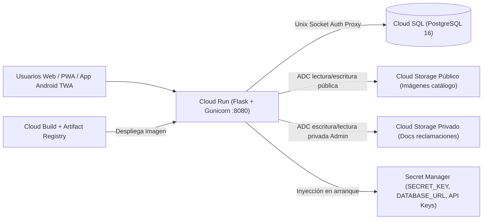

# Guía de Estructuración y Despliegue en Google Cloud Platform (GCP) + Android TWA

Este documento describe la arquitectura de producción recomendada y los comandos paso a paso para desplegar **BeerMap / BeerFinder** en **Google Cloud Platform** como un SaaS sin estado (*stateless*), escalable a cero, seguro y listo para empaquetarse en **Google Play Store** mediante **Trusted Web Activity (TWA)**.

---

## 1. Arquitectura en Google Cloud Platform



### Componentes clave ya integrados en el código
- **Contenedor stateless (`Dockerfile`):** escucha en `PORT=8080` (estándar Cloud Run), ejecuta un usuario sin privilegios (`beerapp`), expone `/health` y lanza `python -m app.bootstrap` antes de iniciar `gunicorn`.
- **Inicializador idempotente (`backend/app/bootstrap.py`):** crea tablas, añade columnas/índices faltantes sin pérdida de datos, siembra automáticamente las **8 familias BJCP, 46 estilos y 24 tags sensoriales** si la base está vacía, y opcionalmente provisiona la cuenta `ADMIN` inicial.
- **Almacenamiento nativo GCS (`backend/app/services/storage.py`):** utiliza **Application Default Credentials (ADC)** de la cuenta de servicio de Cloud Run (`GCS_PUBLIC_BUCKET` y `GCS_PRIVATE_BUCKET`) sin necesidad de descargar claves JSON estáticas.
- **Digital Asset Links (`/.well-known/assetlinks.json`):** endpoint dinámico gobernado por `ANDROID_PACKAGE_NAME` y `ANDROID_SHA256_CERT_FINGERPRINTS` para validar la app Android TWA en Google Play sin recompilar el servidor.

---

## 2. Preparación del Proyecto, APIs e IAM

Define las variables base en tu terminal y habilita las APIs necesarias:

```bash
export PROJECT_ID="tu-proyecto-gcp"
export REGION="europe-west1"              # O europe-southwest1 (Madrid)
export SERVICE_NAME="beermap-web"
export REPO_NAME="beermap-repo"
export SQL_INSTANCE="beermap-pg"
export DB_NAME="beerfinder"
export DB_USER="beerfinder_app"
export PUBLIC_BUCKET="${PROJECT_ID}-beermap-public"
export PRIVATE_BUCKET="${PROJECT_ID}-beermap-claims-private"

gcloud config set project "${PROJECT_ID}"

gcloud services enable \
  run.googleapis.com \
  sqladmin.googleapis.com \
  storage.googleapis.com \
  artifactregistry.googleapis.com \
  cloudbuild.googleapis.com \
  secretmanager.googleapis.com
```

### Cuenta de servicio dedicada (Principio de mínimo privilegio)

```bash
gcloud iam service-accounts create beermap-run-sa \
  --display-name="BeerMap Cloud Run Service Account"

export SA_EMAIL="beermap-run-sa@${PROJECT_ID}.iam.gserviceaccount.com"

# Permiso de conexión a Cloud SQL
gcloud projects add-iam-policy-binding "${PROJECT_ID}" \
  --member="serviceAccount:${SA_EMAIL}" \
  --role="roles/cloudsql.client"
```

---

## 3. Google Cloud Storage (Catálogo Público vs Verificación Privada)

El sistema separa estrictamente las imágenes públicas de cervezas de los documentos legales subidos al reclamar una marca o establecimiento (`DOCUMENT_UPLOAD`):

```bash
# 1. Bucket público para fotos de cervezas (con acceso uniforme IAM)
gcloud storage buckets create "gs://${PUBLIC_BUCKET}" \
  --location="${REGION}" \
  --uniform-bucket-level-access

# Permitir lectura pública de objetos del catálogo y escritura desde Cloud Run
gcloud storage buckets add-iam-policy-binding "gs://${PUBLIC_BUCKET}" \
  --member="allUsers" \
  --role="roles/storage.objectViewer"

gcloud storage buckets add-iam-policy-binding "gs://${PUBLIC_BUCKET}" \
  --member="serviceAccount:${SA_EMAIL}" \
  --role="roles/storage.objectAdmin"

# 2. Bucket PRIVADO estricto para documentos de reclamaciones (CIF, licencias, recibos)
gcloud storage buckets create "gs://${PRIVATE_BUCKET}" \
  --location="${REGION}" \
  --uniform-bucket-level-access \
  --public-access-prevention

gcloud storage buckets add-iam-policy-binding "gs://${PRIVATE_BUCKET}" \
  --member="serviceAccount:${SA_EMAIL}" \
  --role="roles/storage.objectAdmin"
```

> **Seguridad:** `--public-access-prevention` garantiza a nivel de infraestructura que ningún documento de verificación pueda hacerse público por error. Los administradores los revisan únicamente a través del endpoint autenticado `/admin/claims/<id>/document`, que hace *streaming* desde `gs://` verificando el rol `ADMIN`.

---

## 4. Base de Datos Relacional en Cloud SQL (PostgreSQL 16)

Para comenzar con coste contenido (~10–15 USD/mes), utiliza `db-f1-micro` o `db-g1-small` con almacenamiento SSD auto-escalable:

```bash
# Crear instancia PostgreSQL 16
gcloud sql instances create "${SQL_INSTANCE}" \
  --database-version=POSTGRES_16 \
  --tier=db-f1-micro \
  --region="${REGION}" \
  --storage-type=SSD \
  --storage-size=10GB \
  --storage-auto-increase

# Crear base de datos y usuario de aplicación
gcloud sql databases create "${DB_NAME}" --instance="${SQL_INSTANCE}"

export DB_PASS="$(openssl rand -hex 24)"
gcloud sql users create "${DB_USER}" \
  --instance="${SQL_INSTANCE}" \
  --password="${DB_PASS}"
```

La cadena de conexión por **Unix Socket** de Cloud Run tiene este formato:

```text
postgresql+psycopg2://DB_USER:DB_PASS@/DB_NAME?host=/cloudsql/PROJECT_ID:REGION:SQL_INSTANCE
```

---

## 5. Gestión de Secretos en Secret Manager

Guarda todas las credenciales sensibles en **Secret Manager** y otorga acceso de lectura a `beermap-run-sa`:

```bash
# Clave de sesión Flask
openssl rand -hex 32 | tr -d '\n' | gcloud secrets create beermap-secret-key --data-file=-

# URL de conexión a Cloud SQL
printf "postgresql+psycopg2://%s:%s@/%s?host=/cloudsql/%s:%s:%s" \
  "${DB_USER}" "${DB_PASS}" "${DB_NAME}" "${PROJECT_ID}" "${REGION}" "${SQL_INSTANCE}" \
  | gcloud secrets create beermap-database-url --data-file=-

# Password inicial del administrador (usado solo si no existe en BD)
printf "CambiaEstaPasswordSegura2026!" \
  | gcloud secrets create beermap-admin-password --data-file=-

# API Key de Resend (o credenciales SMTP) para envío de códigos OTP
printf "re_tu_api_key_real" \
  | gcloud secrets create beermap-resend-api-key --data-file=-

# Conceder acceso de lectura de secretos a la cuenta de servicio de Cloud Run
for SECRET in beermap-secret-key beermap-database-url beermap-admin-password beermap-resend-api-key; do
  gcloud secrets add-iam-policy-binding "${SECRET}" \
    --member="serviceAccount:${SA_EMAIL}" \
    --role="roles/secretmanager.secretAccessor"
done
```

---

## 6. Build en Artifact Registry y Despliegue en Cloud Run

```bash
# 1. Crear repositorio Docker en Artifact Registry (solo la primera vez)
gcloud artifacts repositories create "${REPO_NAME}" \
  --repository-format=docker \
  --location="${REGION}" \
  --description="Imágenes Docker de BeerMap"

export IMAGE_URI="${REGION}-docker.pkg.dev/${PROJECT_ID}/${REPO_NAME}/${SERVICE_NAME}:latest"

# 2. Construir y subir la imagen con Cloud Build
gcloud builds submit --tag "${IMAGE_URI}" .

# 3. Desplegar en Cloud Run conectado a Cloud SQL, GCS y Secret Manager
gcloud run deploy "${SERVICE_NAME}" \
  --image="${IMAGE_URI}" \
  --region="${REGION}" \
  --platform=managed \
  --allow-unauthenticated \
  --service-account="${SA_EMAIL}" \
  --add-cloudsql-instances="${PROJECT_ID}:${REGION}:${SQL_INSTANCE}" \
  --min-instances=0 \
  --max-instances=5 \
  --memory=512Mi \
  --cpu=1 \
  --port=8080 \
  --set-env-vars="APP_ENV=production,GCS_PUBLIC_BUCKET=${PUBLIC_BUCKET},GCS_PRIVATE_BUCKET=${PRIVATE_BUCKET},MAIL_PROVIDER=resend,MAIL_FROM=BeerMap <verificacion@tudominio.com>,ADMIN_USERNAME=admin,ADMIN_EMAIL=admin@tudominio.com" \
  --set-secrets="SECRET_KEY=beermap-secret-key:latest,DATABASE_URL=beermap-database-url:latest,ADMIN_PASSWORD=beermap-admin-password:latest,RESEND_API_KEY=beermap-resend-api-key:latest"
```

### Verificación tras el primer despliegue
1. En el primer arranque del contenedor, `python -m app.bootstrap` creará todas las tablas en PostgreSQL, insertará los **46 estilos BJCP y 24 tags sensoriales**, y creará el usuario administrador inicial.
2. Comprueba el estado de salud:
   ```bash
   SERVICE_URL="$(gcloud run services describe ${SERVICE_NAME} --region=${REGION} --format='value(status.url)')"
   curl -i "${SERVICE_URL}/health"
   ```
3. Una vez verificado el acceso como administrador, puedes retirar `ADMIN_PASSWORD` de Cloud Run (`--remove-secrets=ADMIN_PASSWORD`) si deseas rotarla desde la aplicación.

---

## 7. Dominio HTTPS, PWA y Publicación Android en Google Play (TWA)

La aplicación ya incluye `manifest.json`, iconos *maskable*, Service Worker (`sw.js`) con página offline y cabeceras `ProxyFix` listas para HTTPS.

### Paso 1: Vincular tu dominio personalizado en Cloud Run
Configura tu dominio (por ejemplo `app.beermap.es`) mediante **Cloud Run Domain Mappings** o **Cloud Load Balancing** para disponer de certificado SSL gestionado automáticamente.

### Paso 2: Generar el paquete Android App Bundle (`.aab`) con Bubblewrap
Con Node.js 18+ y JDK 17 instalados en tu máquina:

```bash
npx @bubblewrap/cli init --manifest="https://app.beermap.es/static/manifest.json"
npx @bubblewrap/cli build
```

Esto genera:
- `app-release-bundle.aab` (listo para subir a **Google Play Console**).
- Tu clave de firma local (`android.keystore`).

### Paso 3: Activar `/.well-known/assetlinks.json` sin tocar código
En **Google Play Console** -> *Configuración* -> *Integridad de la aplicación* (*App signing*), copia la huella **SHA-256** del certificado de firma de Google Play (y opcionalmente la de tu keystore local separadas por comas) y actualiza las variables de Cloud Run:

```bash
gcloud run services update "${SERVICE_NAME}" \
  --region="${REGION}" \
  --update-env-vars="^|^ANDROID_PACKAGE_NAME=es.beermap.app|ANDROID_SHA256_CERT_FINGERPRINTS=AA:BB:CC:DD:...:FF"
```

> **Nota sobre delimitador en gcloud:** El prefijo `^|^` permite pasar múltiples huellas separadas por comas en `ANDROID_SHA256_CERT_FINGERPRINTS` si necesitas autorizar simultáneamente la clave de subida local y la clave definitiva de Google Play Signing.

Comprueba la respuesta inmediata del endpoint requerido por Android:

```bash
curl -s "https://app.beermap.es/.well-known/assetlinks.json"
```

Cuando Android verifica esta coincidencia criptográfica, la app se ejecuta a **pantalla completa nativa** (sin barra de navegador), compartiendo instantáneamente todas las mejoras que despliegues en Cloud Run.
